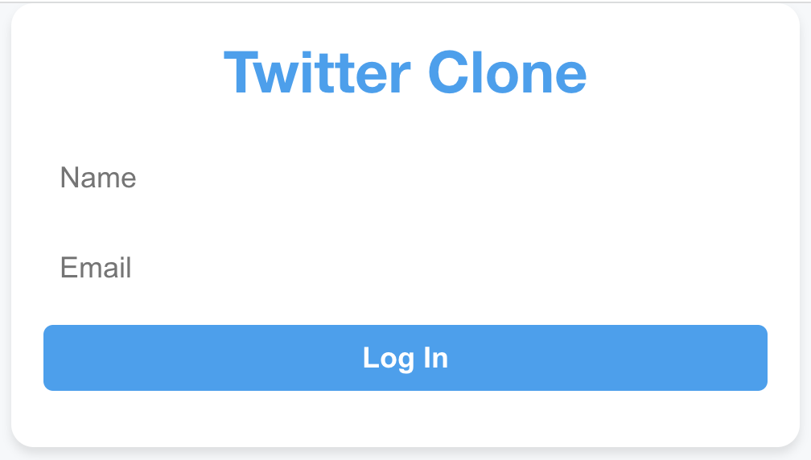
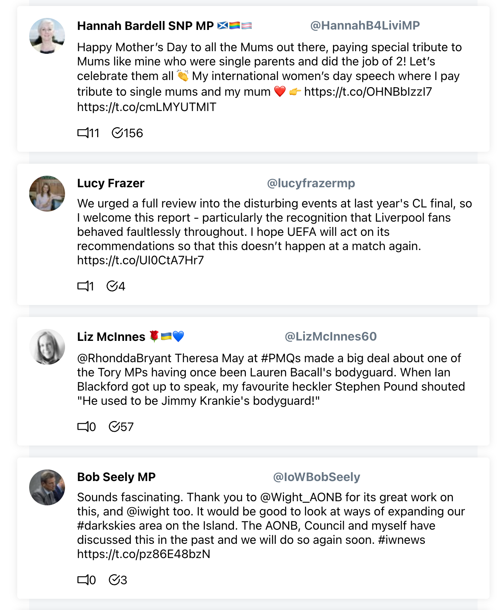

# smclone

Repository for React social media clone environment

To run backend + frontend together: npm run start

To run backend:

```
cd smclone/backend
workon smclone
  # For macOS:
export FLASK_APP=main.py
  # For Windows:
$env:FLASK_APP="main.py"
flask run --port 5001
```

To run frontend:

```
cd smclone/frontend
npm start
```



