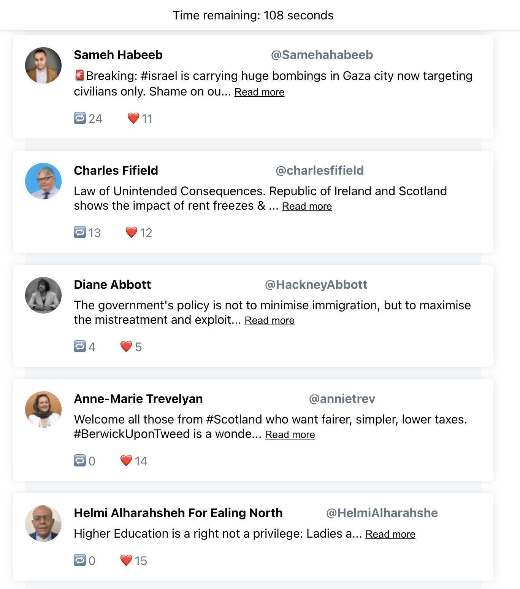

---
output:
  pdf_document: default
  html_document: default
---

**Pre-analysis Plan for "Measuring Attention to Politics Online"**

Christopher Barrie, Aybüke Atalay, Alia ElKattan  
August 26, 2024

### Summary

The goal of this study is to assess the political content that online users pay attention to. Specifically, we are interested in measuring how engagement with political content varies based on users' ideological orientation. 

We plan to achieve this by creating a clone social media platform that looks a lot like the platform Twitter/X. In so doing, we will capture actual user attention to political content beyond traditional engagement metrics like likes or shares.

The motivation for this analysis is to determine whether users pay more attention to content that is politically aligned with their own political beliefs. Additionally, we are interested in how attention---in the way we operationalize it---differs from traditional metrics of attention or interest such as "liking" or "reposting" a piece of online content.

### Hypotheses

We first hypothesize, consistent with published empirical research using eye-tracking softwares, research on the diversity of information diets, and research on selective avoidance, that : 

> *users are no more or less likely to pay attention to content that aligns with their own political orientation*. 

We also hypothesize, consistent with published research on political homophily in online engagement and follow networks, that : 

> *users are more likely to "like" or "retweet" content that aligns with their own political orientation*. 

### Analyses Prior to Pre-Registration

Prior to pre-registration, we conducted a pilot with one hundred participants. The design for the pilot was identical to the setup described below with the exception that did not record the randomized social endorsement metrics. This was because of an omission in the backend programming for the web application. 

We additionally estimated a logistic regression with the collected pilot data. For this regression analysis, we looked only at the association between ideological orientation and attention while controlling for age, gender, education, income, and social media usage. The results from this small sample indicated that there was a significant difference in the coefficient sizes and directions when estimating the probability of "liking" or "retweeting" a piece of online content compared to when simply clicking "Read more." Specifically, users tended to like or retweet content they likely agreed with (politically aligned content); whereas there was no significant association for our measure of attention and whether the user likely agreed with the piece of content.

### Empirical Strategy

To identify the factors that influence user attention to political content, we will use a binary outcome model that predicts whether a user clicks to "Read more" on political tweets. Our main explanatory variable is user-reported ideological orientation. The only other variable of relevance for political attention is a scale measure of political interest. Alongside these, we record gender, age, highest level of education, frequency of social media use, and diversity of news consumption.We will collect data on these variables through a post-experiment questionnaire administered to participants. At the tweet level, we will record social endorsement as (randomized) retweet and like counts.

#### Regression Model

We will estimate the following main logistic regression model:

\[
\text{log} \left( \frac{\text{Pr}(Y_{ij} = 1 | P_i, X_i)}{1 - \text{Pr}(Y_{ij} = 1 | P_i, X_i)} \right) = \beta_0 + \beta_1 P_i + \delta^T X_i
\]

Where:
- \( Y_{ij} \) is the binary outcome indicating whether the user clicked to "Read more" on a right-wing tweet (1 = yes, 0 = no).
- \( P_i \) is the user's political orientation on a left-right scale.
- \( X_i \) includes other covariates measuring political interest as well as age, gender, education, income, social media usage, and social endorsement.

We will then estimate the same regression model but we will change the outcome variable to be binary indicating whether the user clicked the "Like" button a right-wing tweet or the "Retweet" button on a right-wing tweet. That is, in total we will estimate six main regression models. To compare coefficients across models, we will compute predicted probabilities. 

### Data and Methods

- **Unit of Analysis**: The individual tweet and the user's interaction with it (e.g., whether they clicked to "Read more"). Users have the option of clicking "Read more," "Like," or "Retweet" on 0 tweets or as many tweets as there are on the platform.

- **Data Collection**: We have collected tweets from political candidates in the 2024 UK General Election, which were then classified on a left-right political spectrum. We chose to seed our sample of tweets this way as we wanted to sample political social media content. We assumed that individuals who would later become candidates in the UK General Election, were likely to tweet about political issues. We went on take a subsample of these tweets by filtering the data to include only posts from May 22, 2023 to May 22, 2024---i.e., the one-year period before the snap General Election announcement. We also filtered out any retweets or replies to other posts before taking a subsample of 10k posts. To classify these, we first used the gpt-4 language model from OpenAI, prompting the model to classify the individual tweet with the following prompt:

> \texttt{This task involves reading some tweets by individual UK MPs or users who are or will later become candidates in the General Election in the UK in 2024. On the basis of its content, you are asked to score the political stance of the text on a scale from Very Left to Very Right.}

The authors then manually validates these tweets by agreeing upon a coding that ran from "Very left," to "Somewhat left," to "Neither," to "Somewhat right," to "Very right." Finally, we excluded posts that cued neither left-wing or right-wing opinion. Then we took a sample of 100 posts by sampling 25 from each left- or right-wing category. 

- **Web Application**

Participants will be presented with a simulated social media feed consisting of these tweets, and their interactions will tracked with a commercial online product analytics JavaScript tool called PostHog. The order of the tweets will be entirely randomized. Additionally, we will randomize the number of retweets or likes for each tweet. The rationale for this is that we want to control for the effect of social endorsement independent of actual tweet quality (i.e., the actual engagements the tweet received). Respondents will have 120 seconds to interact with the platform. They will be told before commencing study only that the purpose of this research is to understand how users interact with social media. 

```{r, echo=FALSE, out.width='60%', fig.align='center', fig.cap="Screenshot of social media clone environment"}

```

### Outcome

- **Primary Outcome**: The primary measure (estimand) is whether the user clicked to "Read more" on a tweet. This reflects actual attention given to political content. We will estimate the association between ideological outlook and attention to tweets using the above estimation strategy. We will then compare this to the association with likes and retweets. We will compare between models with different outcomes by computing the predicted probability of clicking on one of these outcomes as a function of ideological orientation. 

### Weighting

We do not anticipate the need for weighting as we will not be collecting a representative sample of the general UK population in the first instance. However, in exploratory analyses, we may weight responses by e.g., the frequency of social media usage to account for varying exposure levels.

### Additional Analysis

- **Social Endorsement Effects**: We may explore the influence of social endorsement (likes and retweets) on user attention to political content, controlling for ideological alignment.
- **Partisanship Effects**: We may conduct subgroup analyses on strong partisans as there is evidence that particularly partisan users pay more attention to content from their political ingroup.
- **Time Spent on Content**: We may analyze the amount of time users spend on each tweet as an alternative measure of attention. To do so, we will use the screen recording function available through PostHog. 

### Question wordings:

\subsection{Political/Ideological Orientation}
\label{sec:pol_orientation}
\textbf{Question:} In political matters, people talk of ``the left" and ``the right." How would you place your views on this scale, generally speaking?\\
\textbf{Scale:} 0 (Left) to 10 (Right)\\

\subsection{Party Identification (Party ID)}
\label{sec:party_id}
\textbf{Question:} Generally speaking, do you think of yourself as Labour, Conservative, or some other party?\\
\textbf{Options:} Conservative, Labour, Other (with a box for entry)\\


\subsection{Strength of Party ID}
\label{sec:party_id_strength}
\textbf{Question:} Would you call yourself a very strong supporter of this party, fairly strong, or not very strong?\\
\textbf{Response format:} 3-point scale (Very strong, Fairly strong, Not very strong)\\

\subsection{Political Interest}
\label{sec:pol_interest}
\textbf{Question:} How interested would you say you are in politics?\\
\textbf{Response format:} 5-point Likert scale ranging from `Not at all interested' to `Very interested'\\

\subsection{Social Media Use}
\label{sec:soc_media_use}
\textbf{Question:} On which social media sites do you currently have an account or profile?\\
\textbf{Options:} 
\begin{itemize}
    \item Facebook
    \item TikTok
    \item Instagram
    \item LinkedIn
    \item Pinterest
    \item Snapchat
    \item Twitter
    \item YouTube
    \item Reddit
    \item Other
\end{itemize}
\textbf{Response format:} Yes/No/Don't know\\

\subsection{Age}
\label{sec:age}
\textbf{Question:} What is your age (Age in years)\\

\subsection{Gender}
\label{sec:gender}
\textbf{Question:} What is your gender (Male; Female; Other; Prefer not to say)\\

\subsection{Educational Attainment}
\label{sec:edu_attainment}
\textbf{Question:} At what age did you finish full-time education?\\
\textbf{Options:}
\begin{itemize}
    \item 15 or under
    \item 16
    \item 17-18
    \item 19
    \item 20+
    \item Still at school/Full time student
    \item Can't remember
    \item Not applicable
\end{itemize}

\subsection{Income}
\label{sec:income}
\textbf{Question:} What is your total household income before taxes?\\
\textbf{Options:}
\begin{itemize}
    \item Less than £5,000
    \item £5,000–£9,999
    \item £10,000–£14,999
    \item £15,000–£19,999
    \item £20,000–£24,999
    \item £25,000–£29,999
    \item £30,000–£34,999
    \item £35,000–£39,999
    \item £40,000–£44,999
    \item £45,000–£49,999
    \item £50,000–£59,999
    \item £60,000–£69,999
    \item £70,000–£99,999
    \item £100,000–£149,999
    \item £150,000 or more
    \item Prefer not to say
\end{itemize}

\subsection{News Diet Diversity}
\label{sec:news_diet}
\textbf{Question:} When looking for information about political news, issues, or elected officials, how often do you go to the following sources (either online or offline)?\\
\textbf{Options:}
\begin{itemize}
    \item BBC News
    \item ITV News
    \item Sky News
    \item Channel 4 News
    \item Daily Mail/Mail on Sunday
    \item Commercial radio news
    \item Regional or local newspaper
    \item GB News
    \item Guardian/Observer
    \item Metro
    \item Sun/Sun on Sunday
    \item The Times/Sunday Times
    \item Al Jazeera
    \item Daily Telegraph/Sunday Telegraph
    \item Channel 5 News
    \item CNN
\end{itemize}
\textbf{Response format:} 5-point Likert scale ranging from 'Never' to 'Very often'\\
\textbf{Operationalization:} Sum of the product of Likert scale scores and political leaning score of each outlet, which went from -1 (Left) to 0 (Non-biased) to 1 (Right).\\

\subsection{Attention Check}
\label{sec:attention_check}
\textbf{Question:} Did you see a tweet by the following individuals on the simulated social media feed you just used? (Yes/No)\\
\textbf{Individuals:}
\begin{itemize}
    \item Boris Johnson
    \item Theresa May
    \item Nicola Sturgeon
\end{itemize}